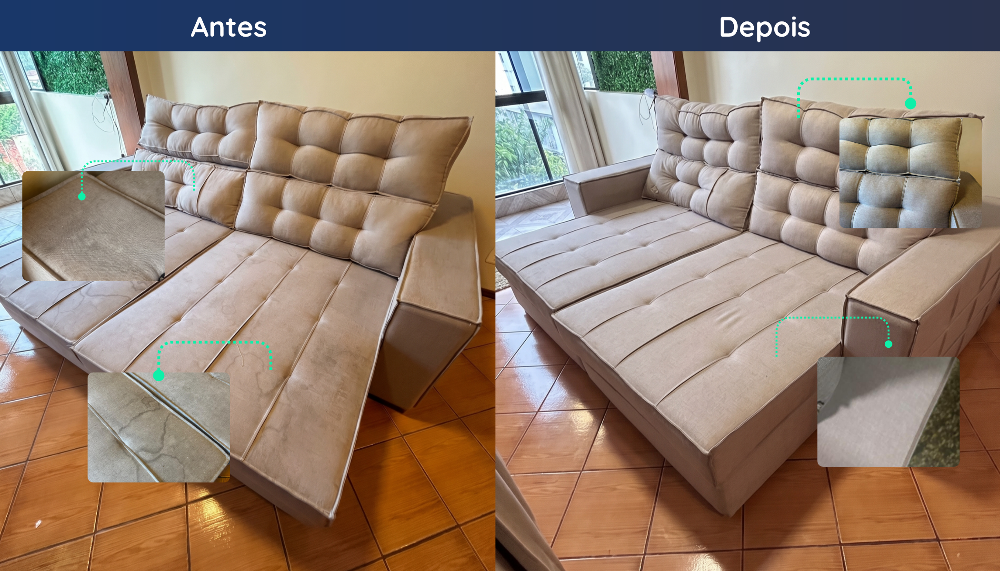

<!doctype html>
<html lang="pt-BR">
<head>
<meta charset="UTF-8">
<meta name="viewport" content="width=device-width, initial-scale=1">
<meta name="theme-color" content="#20375f">
<meta name="description" content="Novembro Clean — preço especial em combos de sofá até 30/11. Higienização e impermeabilização de estofados em Novo Hamburgo e região.">
<title>Novembro Clean | Clean Up</title>

<link rel="preconnect" href="https://fonts.googleapis.com">
<link rel="preconnect" href="https://fonts.gstatic.com" crossorigin>
<link href="https://fonts.googleapis.com/css2?family=DM+Sans:wght@400;500;600;700;800&family=Playfair+Display:wght@500;600;700&display=swap" rel="stylesheet">

</head>

<body>

<header>
  

    <a class="brand" href="#inicio" aria-label="Clean Up — início">
      <svg viewBox="0 0 64 72" role="img" aria-label="Logo Clean Up">
        <path
          d="M32 4C23 17 8 34 8 46a24 24 0 0 0 48 0c0-7-5-17-10-24"
          fill="none"
          stroke="#0DF0A9"
          stroke-width="4.5"
          stroke-linecap="round"
        />
        <path
          d="m44 20 4 9 7-7"
          fill="none"
          stroke="#0DF0A9"
          stroke-width="4"
          stroke-linecap="round"
          stroke-linejoin="round"
        />
      </svg>
      
        <b>Clean Up</b>
        <small>Limpeza e impermeabilização</small>
      
    </a>

    <nav class="nav">
      <a href="#servicos">Orçamento</a>
      <a href="#resultados">Resultados</a>
      <a href="#atendimentos">Atendimentos</a>
    </nav>

    <a class="btn primary" data-wa>WhatsApp ↗</a>

  

</header>

<main id="inicio">

  <section class="hero">
    

      

        Campanha especial de novembro

        <h1>
          Novembro <em>Clean.</em>
          
            Preço especial em combos de sofá
            <em>até 30/11.</em>
          
        </h1>

        

          Renove seus estofados com higienização profissional
          e proteção. Monte sua estimativa e encaminhe os
          detalhes diretamente para a Clean Up.
        

        

          <a href="#servicos" class="btn primary">
            Montar meu orçamento ↗
          </a>
          <a class="btn outline" data-wa>
            Pedir atendimento
          </a>
        

      

      

        
        

          <strong>Resultado real</strong> • Sofá familiar de linho
        

      

    

  </section>

  

    ✦ COMBOS DE SOFÁ COM PREÇO ESPECIAL ATÉ 30/11
    &nbsp; ✦ ATENDIMENTO NO VALE DOS SINOS
  

  <section class="section" id="servicos">
    

      

        

          
            Orçamento online
          
          <h2>
            Seu estofado merece <em>cuidado.</em>
          </h2>
        

        

          Adicione os móveis, escolha o tecido e informe se há manchas.
          A estimativa é atualizada automaticamente.
        

      

      

        

        <aside class="quote" aria-live="polite">
          Novembro Clean
          <h3>Sua estimativa</h3>

          

            

              Adicione um móvel para calcular.
            

          

          <a
            class="btn primary"
            id="enviar"
            target="_blank"
            rel="noopener"
          >
            Enviar pelo WhatsApp ↗
          </a>

          

            Valor estimado. O orçamento final é confirmado
            após avaliação das fotos.
          

        </aside>

      

    

  </section>

  <section class="section showcase" id="resultados">
    

      

        
          Antes e depois
        

        <h2>O resultado está nos detalhes.</h2>

        

          Veja o antes e depois de um sofá familiar.
          Cada estofado recebe uma avaliação individual
          conforme seu tecido, uso e tipo de mancha.
        

        <a class="btn primary" href="#servicos">
          Quero uma estimativa ↗
        </a>
      

      

    

  </section>

  <section class="section" id="atendimentos">
    

      
        Área de atuação
      

      <h2 style="font:600 2.7rem 'Playfair Display',serif;color:var(--dark);margin:10px 0">
        Atendimentos
      </h2>

      
Atendemos as seguintes cidades e região:

      

      <a class="btn primary" data-wa>
        Solicitar atendimento ↗
      </a>

    

  </section>

</main>

<footer class="bottom">
  

    

      <strong>Clean Up</strong> 
      Higienização e impermeabilização de estofados.
    

    

      <b>Contato</b> 
      <a data-wa>(51) 99421-6493</a> • João Lucas
    

    

      <b>Instagram</b> 
      <a href="https://instagram.com/cleanup_nh" target="_blank" rel="noopener">
        @cleanup_nh
      </a>
    

  

</footer>

  <a class="btn outline" href="#servicos">Calcular</a>
  <a class="btn primary" data-wa>WhatsApp ↗</a>

</body>
</html>
